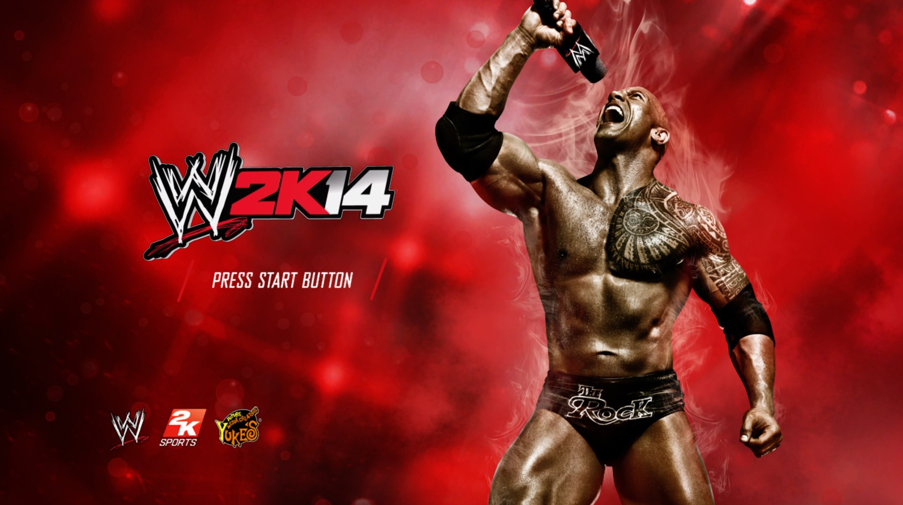
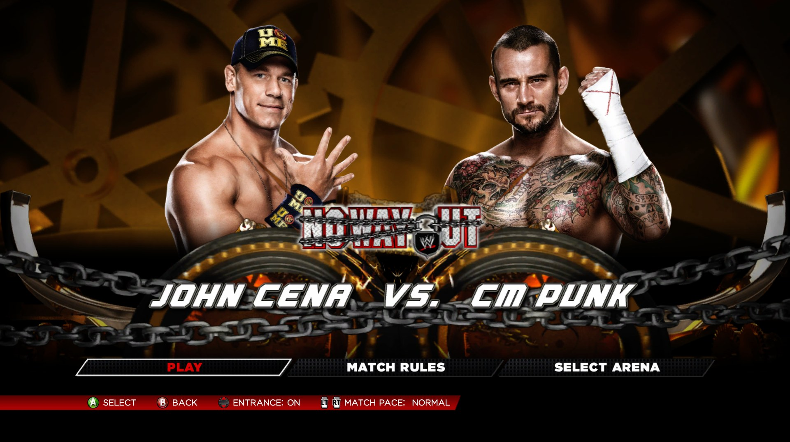
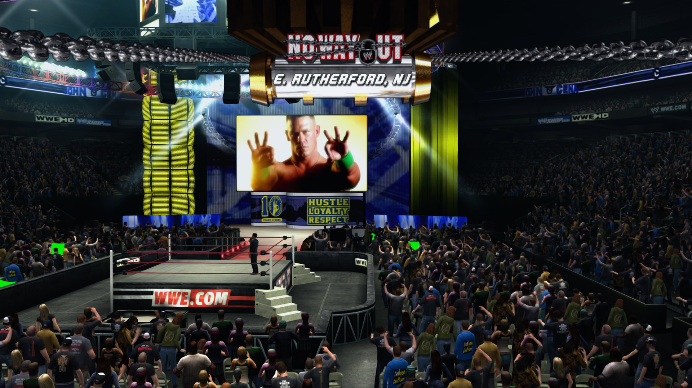
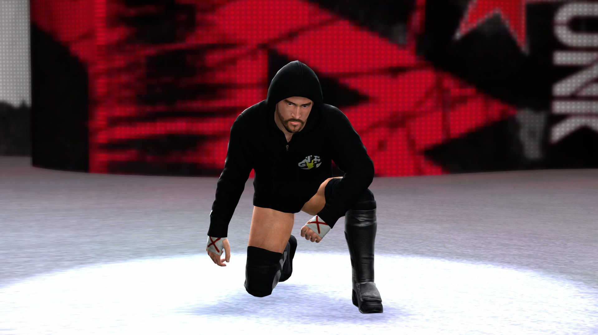

# WWE 2K14 Recomp

An unofficial **native PC port of WWE 2K14 (Xbox 360)**, made by static recompilation. The game's original PowerPC
code is translated ahead of time into C++ and compiled into a normal 64-bit Windows program. It is not an emulator:
there is no CPU interpreter or JIT, and the game runs at native speed on top of a Vulkan graphics backend.

> **You must own the game.** This repository contains **no game code, no game files and no assets**. You build it
> yourself from your own legally obtained Xbox 360 copy of WWE 2K14 with title update 2.0.1.0. See
> [DISCLAIMER.md](DISCLAIMER.md).

## Screenshots

Running natively on Windows (1440p, 60 FPS):

| | |
|---|---|
|  |  |
|  |  |

## Status

| | |
|---|---|
| Boot, legal screen, 2K logo, menus | ✅ |
| Exhibition matches, entrances, commentary | ✅ |
| WrestleMania mode | ✅ played through several matches |
| Saves | ✅ (stored in `userdata/`) |
| 60 FPS gameplay | ✅ (entrances and cutscenes keep the game's own 30 FPS, so they play at natural speed) |
| Resolution | 720p (native), 1440p, 4K, or **4K-FSR** (1440p render + AMD FSR upscale: close to 4K at 1440p speed) |
| Cloth (jackets, dresses: e.g. Bobby Heenan, Miss Elizabeth) | ✅ fixed |
| Managers and alternate attires (black or rainbow-striped models) | ✅ fixed in the launcher (`texture_fix=on`) |
| Menu music, entrance themes, commentary | ✅ |
| DLC packs | supported via `install-dlc.bat` (installer tested on package format; in-game DLC testing welcome) |
| Mods (file replacement) | drop-in through `update\` (see [Mods](#mods)) |
| Universe, Creation Suite, every arena and wrestler | not fully tested yet; please report issues |

Tested on Windows with an NVIDIA RTX 3080: smooth 60 FPS at 1440p and 4K-FSR.

## Playing (Windows)

You need your own WWE 2K14 game files and a Vulkan-capable GPU.

1. **Download** `WWE2K14-Recomp-v1.0.zip` from [Releases](https://github.com/mikeflare007/wwe2k14-recomp/releases)
   and unzip it anywhere. It contains the game program and launcher only, no game files.
2. **Game files:** extract your own WWE 2K14 Xbox 360 disc (for example with `extract-xiso`) into the `game` folder,
   so that `game\default.xex` exists. Or keep it anywhere and set `game_folder=` in `settings.txt`.
3. **Title update 2.0.1.0** (media ID `0D94D1D2`): put your own TU file (named like `tu00000002_00000000`) in the
   `title-update` folder. The launcher unpacks it on the first start (needs [Python 3](https://www.python.org), with
   "Add python.exe to PATH" ticked).
4. Edit `settings.txt` if you like, then double-click `play-wwe2k14.bat`.

You can also build `wwe2k14.exe` yourself; see [Building](#building).

The first matches can stutter for a moment whenever something new appears (a new wrestler, arena or effect): its
graphics shaders are being built. They are cached in `userdata/`, so it gets smoother the more you play.

### Settings (`settings.txt`)

| Setting | Values |
|---|---|
| `game_folder` | your extracted game folder (empty = `game` next to the launcher) |
| `resolution` | `720p`, `1440p`, `4k`, `4k-fsr` |
| `fps` | `original` (60, with entrances and cutscenes at 30), or `60` (everything at 60; entrances run too fast) |
| `fullscreen` | `yes` / `no` (F11 toggles in game) |
| `texture_fix` | `on` (default) / `off`: copies the textures the game builds for managers and alternate attires back from the GPU, so they don't render black or striped |

Keyboard and mouse work through the built-in controller emulation, and Xbox controllers work as normal.

### DLC

Bring your own WWE 2K14 DLC package files (the Xbox 360 `LIVE`/`PIRS` files from your console's storage). **Drag the package
files, or a folder of them, onto `install-dlc.bat`** (needs [Python 3](https://www.python.org)). Each pack is unpacked
into `userdata/0000000000000000/545408B2/00000002/` with a content header, which is where the game looks for
marketplace content. Packages for other games and title updates are skipped. To remove a pack, delete its folder and
its `.header` file.

### Mods

The game checks the `update\` folder before the disc for every file it loads, because that is how the title update
replaces files. So a modded file placed in `update\` under the same path as on the disc (for example
`update\pac\ch\ch123.pac`) is used instead of the original. Keep a backup of anything you replace, and test one mod at
a time.

## Building

Full instructions: [docs/BUILDING.md](docs/BUILDING.md). The short version (Ubuntu 24.04 host, LLVM 20; Windows is
cross-compiled from Linux):

```bash
./tools/setup.sh                       # fetch + patch + build the ReXGlue SDK next to this repo
cp /your/game/default.xex  game/       # your own files, never committed
cp /your/update/default.xexp game/
./tools/codegen.sh                     # recompile the game code into generated/ (local only)
python3 tools/check-generated.py       # safety checks on the generated code
./tools/build-windows.sh               # -> out/build/win-amd64-cross/RelWithDebInfo/wwe2k14.exe
```

## How it works, and what was fixed

WWE 2K14 runs on the same Yuke's engine as WWE '13, so this port starts from
[WWE '13 Recomp](https://github.com/PromethenDev/wwe13-recomp) and its ReXGlue SDK changes, then adds everything
2K14 needed. Main 2K14 work:

- **Function map for the TU 2.0.1.0 executable** (`config/functions.toml`). Static recompilation must know where every
  function starts. The analyzer misses functions that are only ever called through pointers, which crashes the game
  the first time one runs. Two audits found them: pointer targets in data and code, plus an orphan scan for
  straight-line code blocks that no branch reaches.
- **The legal-screen freeze.** Some pattern-found entries were really the `case` blocks of `switch` statements. The
  split turned each `bdzf` case branch into a plain `return`, so the scene state machine never left the legal screen.
  [`tools/check-generated.py`](tools/check-generated.py) now refuses any output with that pattern.
- **Cloth race** (`src/cloth_handshake_2k14.cpp`). On PC the Havok cloth thread can finish before the game clears its
  "done" event, so the signal is lost and jackets and dresses rendered as garbage. The fix clears the event before
  signalling the thread.
- **60 FPS** (`src/present_interval_2k14.cpp`). The game's present-interval setter is overridden, with an opt-out that
  keeps the original timing.
- **4K / 4K-FSR**: integer resolution scaling, plus FSR upscaling at present time.
- **Music**: the Xbox music-player (XMP) controller is reported as idle, the way Xenia does. This stops the game from
  muting its own soundtrack.
- **Diagnostics**: an import-call tracer (`REX_IMPORT_TRACE=1`) and a startup-sequence probe (`WWE13_STARTUP_PROBE=1`)
  that compare the port against Xenia call by call.

Engine-side changes are in `rexglue-patches/` (patches 0100 and later are 2K14 work).

## Reporting a problem

Open an issue with what you were doing, your GPU, and the newest log from `logs/`. Never attach game files or
saves that contain game data.

## Credits

- **[WWE '13 Recomp](https://github.com/PromethenDev/wwe13-recomp)** by PromethenDev and contributors: the base of
  this port (BSD 3-Clause).
- **ReXGlue SDK** by Tom Clay, via the
  [rexglue-sdk-yukes](https://github.com/HollywoodAkeem/rexglue-sdk-yukes) fork (BSD 3-Clause).
- **[Xenia](https://xenia.jp)** by Ben Vanik and contributors: ReXGlue's kernel and GPU code is derived from it. Xenia
  Canary was also the reference used to find 2K14's bugs.
- Third-party libraries (SDL, FFmpeg, Vulkan, fmt, spdlog and others) under their own licenses; see the SDK's
  `thirdparty/` folder.
- WWE 2K14 port: [mikeflare007](https://github.com/mikeflare007) and Claude (Anthropic).

## License

This project's own source code is under the [BSD 3-Clause License](LICENSE), which keeps the original WWE '13 Recomp
and ReXGlue copyright notices. It grants **no** rights to WWE 2K14 or any game content. "WWE" and "2K" are
trademarks of their owners. This is an unofficial fan project, not affiliated with or endorsed by WWE, 2K, Take-Two,
Yuke's or Microsoft.
